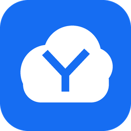
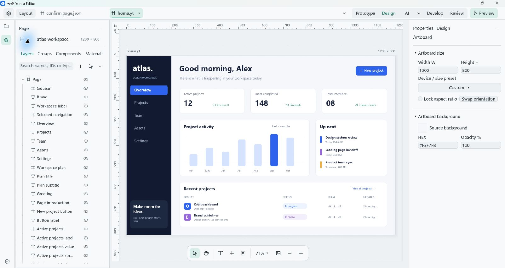
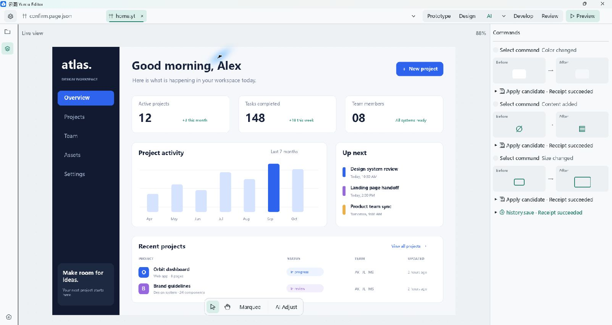

<h1> Yuntu Editor</h1>

**Build with AI. Review precisely. Generate your way.**

A visual UI workspace for Windows, built with Rust.

**1.0.0-beta** · Windows x64 · 111 MiB installer

[Release notes](docs/release/1.0.0-beta/README.md) · [Installation guide](docs/guides/installing-a-release.md) · [SHA-256 checksums](https://github.com/clouddance-studio/yuntu-releases/releases/download/v1.0.0-beta/SHA256SUMS.txt)

*An original sample dashboard in the actual Yuntu Editor 1.0.0-beta design workspace.*

## From an idea to a working interface

See what AI changed, refine it visually, and export the result for your own development workflow. Yuntu brings local visual editing, object-specific review, previews, and structured handoff into one workspace.

| Design visually | Work with AI | Hand off your way |
| --- | --- | --- |
| Arrange pages, text, images, and containers. Refine geometry, layout, fonts, and appearance with editable layers. | Connect an external MCP client. Inspect supported changes, compare results, and selectively undo edits. | Export versioned JSON, source mappings, and assets. Use an official exporter or register your own generator. |

## See what AI changed

Keep the result visible while your external client works. Inspect supported before-and-after changes and command receipts beside the page. This sample was edited through MCP; the screenshot shows its recorded changes in the AI workspace.

[Set up the Skill and MCP connection →](docs/guides/ai-mcp.md)

## Get started

1. **[Download the Windows installer](https://github.com/clouddance-studio/yuntu-releases/releases/download/v1.0.0-beta/Yuntu-Editor-1.0.0-beta-windows-x64-setup.exe)** and follow the [installation guide](docs/guides/installing-a-release.md).
2. **[Create your first project](docs/guides/getting-started.md).** Your editable `.yt` documents, `.thme` themes, manifests, and assets stay in local project directories.
3. **[Connect an AI client](docs/guides/ai-mcp.md)** if you want AI-assisted editing. Client software and model access are separate requirements.
4. **[Validate, preview, and export](docs/guides/mcp-validation-preview-export.md)** the intended revision, then verify the completed output.

### Optional AI integration downloads

| Download | What it contains |
| --- | --- |
| [MCP bridge 0.2.0](https://github.com/clouddance-studio/yuntu-releases/releases/download/v1.0.0-beta/Yuntu-MCP-0.2.0.zip) | Four-tool stdio bridge, sibling API helper, provenance, and protocol tests. Python is required separately. |
| [Yuntu Editor Skill](https://github.com/clouddance-studio/yuntu-releases/releases/download/v1.0.0-beta/Yuntu-Skill-1.0.0-beta.zip) | User-facing instructions for supported design, review, and export workflows. |

The installer includes its own bridge snapshot. To use the separate 0.2.0 four-tool bundle, follow the [setup instructions](docs/guides/ai-mcp.md) and keep its two Python scripts together.

<strong>Beta scope, installation, and compatibility</strong>

This is a **Windows x64 prerelease**. Installation acceptance was confirmed by the release owner. The installer is unsigned; review its [exact identity, signing state, known issues, and verification limits](docs/release/1.0.0-beta/README.md) and compare the published checksum before use. Back up important projects before beta upgrades.

- Preview, media, animation, and export coverage varies by document, control, effect, and target. Supported animation and recording workflows can export video; some video previews are silent.
- JSON is Yuntu's versioned exchange format. The installer includes official Web, WeChat Mini Program, Android, and iOS exporter packages. Generated output needs integration with application logic and validation in its target environment.
- The optional official Web exporter produces React / TypeScript for a supported subset. Format, bridge, and generator versions are independent of the application version.
- Production account services, subscriptions, hosted collaboration, cloud project storage, and trusted automatic updates are not presented as available beta features. Team-related text in the sample dashboard is demo content.
- Microsoft Store/MSIX and the company website remain separate preparation work. No verified Store installation link is announced here.

## Documentation

[Installation](docs/guides/installing-a-release.md) · [First project](docs/guides/getting-started.md) · [AI setup](docs/guides/ai-mcp.md) · [Validation and export](docs/guides/mcp-validation-preview-export.md) · [FAQ](docs/guides/faq.md) · [Support reports](docs/guides/support.md)

## About this repository

Maintained by **Cloud Dance**. This repository provides Yuntu Editor release information, documentation, and the external integration bundle. The Rust desktop application source is maintained separately; GitHub's automatic source ZIP is not the editor installer.

Editor usage terms and reuse permissions are provided with their respective materials. Third-party components retain their own licenses. See the [release record](docs/release/1.0.0-beta/README.md), [documentation index](docs/README.md), and [capture provenance](docs/release/screenshots.md).
